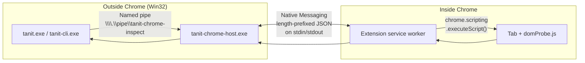
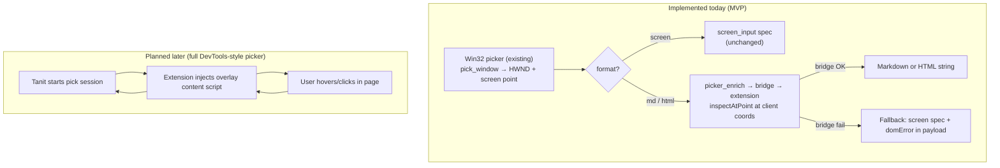
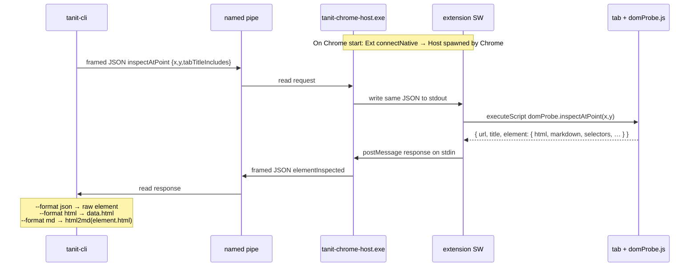

# Chrome Element Picker Architecture (Win32 C++)

> **See also:** [Window Inspect / Picker (`inspect.md`)](./inspect.md) — Win32 HWND/UIA picker (`pick_window`).  
> This doc covers **Chrome DOM** inspection via the Tanit MV3 extension + native host bridge.

## Implementation status (2026-03)

| Area | Status |
|------|--------|
| MV3 extension + `domProbe.js` | **Shipped** — `dist/extension/tanit-chrome/` |
| Native host + named pipe bridge | **Shipped** — `tanit-chrome-host.exe`, `bridge.cpp` |
| Assistant CLI `chrome-inspect` | **Shipped** — `--format json\|md\|html` |
| xblox `picker` block `format=md\|html` | **Shipped** — Win32 pick + `inspectAtPoint` enrich |
| Dev install (`npm run install:tanit-chrome*`) | **Shipped** — registry + load-unpacked helper |
| In-page DevTools overlay picker | **Not started** |
| Production installer native-host reg | **Not started** (dev uses npm script) |

**Verified manually:** `assistant chrome-inspect status --json` → `nativeHost: "connected"`; xblox picker `format=md` on real Chrome tabs returns Markdown (via `packages/html`).

## Goal

Implement a VSCode/DevTools-style element picker for external Chrome windows, initiated from a native Win32 C++ application.

The picker should:

- start from the C++ application
- work with any normal Chrome tab
- highlight elements under the cursor
- display overlay information
- capture the selected element
- return rich metadata back to the C++ application
- require no remote debugging port
- be secure and production ready

---

# Understanding the bridge (read this first)

Tanit runs **outside** Chrome. The Tanit Chrome extension runs **inside** Chrome. Those two processes cannot talk to each other directly — Chrome’s security model blocks it.



## Why not skip `tanit-chrome-host.exe`?

| If Tanit tried to… | Chrome allows it? | Why |
|--------------------|-------------------|-----|
| Open a socket/pipe **into** the extension | No | Extensions cannot accept arbitrary local connections |
| Read the page DOM from C++ directly | No | Page memory lives inside the renderer sandbox |
| Call the extension API from C++ | No | Only JavaScript inside Chrome can use `chrome.*` APIs |
| Use **Native Messaging** (`connectNative`) | Yes | Chrome **spawns a registered exe** and pipes JSON to it |
| Use **CDP** (`--remote-debugging-port`) | Yes | Different architecture — no extension required for DOM |

So: **some registered native process is mandatory** if Tanit (outside) drives an extension (inside). That process does not have to be a separate small exe forever — `tanit.exe` could be registered as the native host instead — but you cannot eliminate native messaging entirely while keeping this extension-led design.

## What each piece expects

```text
┌─────────────────────────────────────────────────────────────────────────┐
│  Tanit (C++)                                                            │
│  • bridge.cpp → connect to \\.\pipe\tanit-chrome-inspect                │
│  • Sends: { protocolVersion, requestId, command, payload }              │
│  • Used by: assistant chrome-inspect, picker block format=md|html       │
└───────────────────────────────┬─────────────────────────────────────────┘
                                │ named pipe (our IPC)
                                ▼
┌─────────────────────────────────────────────────────────────────────────┐
│  tanit-chrome-host.exe  (dist/extension/tanit-chrome/, built by npm run build:cpp) │
│  • Chrome launches it when extension calls connectNative()              │
│  • Also runs a pipe server so Tanit can send requests                   │
│  • Relays: pipe frame → stdout → extension → stdin → pipe frame         │
└───────────────────────────────┬─────────────────────────────────────────┘
                                │ Chrome Native Messaging (stdio JSON)
                                ▼
┌─────────────────────────────────────────────────────────────────────────┐
│  Tanit Chrome MV3 extension  (dist/extension/tanit-chrome/)            │
│  • background.ts: connectNative("com.polymech.tanit.chrome") on startup │
│  • Dispatches: ping, getStatus, inspectAtPoint, inspectSelector       │
│  • Injects domProbe.js, returns element JSON (+ html, markdown fields)  │
└───────────────────────────────┬─────────────────────────────────────────┘
                                │ scripting API
                                ▼
                         Page DOM in active tab
```

**Registry / manifest (one-time setup):** Chrome looks up  
`HKCU\Software\Google\Chrome\NativeMessagingHosts\com.polymech.tanit.chrome`  
→ JSON file pointing at `tanit-chrome-host.exe` and allowing extension ID  
`bhpeejlpjkdlbibojmbdhdcondflmban`. Template: `apps/tanit-chrome/native/com.polymech.tanit.chrome.json`.

Without that registration, the extension still loads but `getStatus.nativeHost` stays `"disconnected"` and Tanit’s pipe calls fail.

## Two ways to pick (today vs planned)



**Today:** the native Win32 picker chooses the target; DOM enrichment is a **point lookup** (`inspectAtPoint`), not an in-page overlay yet.

**Later:** the extension owns hover highlight + click inside the tab (sections below on overlay/content script still apply to that phase).

## Request sequence (assistant `chrome-inspect at-point`)



Test harness: `npm run test:assistant-chrome:build` (main build + extension + Puppeteer fixture).

---

# Quick start (development)

Build once:

```text
npm run build:cpp
npm run build:tanit-chrome
```

Install native host + extension (Windows):

```text
npm run install:tanit-chrome          # register HKCU native host + print Load unpacked path
npm run install:tanit-chrome:launch   # same + launch real Chrome with extension loaded
npm run install:tanit-chrome:full     # build + register + launch
```

Verify bridge:

```text
tanit-cli assistant chrome-inspect status --json
```

Expect `"nativeHost": "connected"` when Chrome is open with the extension loaded.

Try DOM inspect:

```text
tanit-cli assistant chrome-inspect selector --json --selector "h1" --tab-title "Partial title"
tanit-cli assistant chrome-inspect at-point --json --format md --x 200 --y 300 --tab-title "Partial title"
```

xblox `picker` block options:

| Param | Values | Notes |
|-------|--------|-------|
| `format` | `screen` (default), `md`, `html` | `screen` = capture spec; `md`/`html` = DOM string |
| `chromeDom` | `true` (default) | When `format` is `md`/`html`, call extension bridge; on failure fall back to screen spec + `domError` in payload |

After rebuilding `tanit-chrome-host.exe`, **reload the extension** (or restart Chrome) so Chrome spawns the new host — the old process locks the exe and can leave a stale pipe server.

---

# Troubleshooting

| Symptom | Likely cause | Fix |
|---------|----------------|-----|
| `assistant chrome-inspect: ReadFile failed` | Stale `tanit-chrome-host.exe` (pipe zombie) or host not rebuilt after code change | Kill `tanit-chrome-host.exe` in Task Manager; reload extension; `npm run build:cpp`; `npm run install:tanit-chrome` |
| `nativeHost: "disconnected"` in extension | Registry manifest missing/wrong path | `npm run install:tanit-chrome` |
| Bridge unavailable | Extension not loaded in Chrome | Load unpacked `dist/extension/tanit-chrome` or `npm run install:tanit-chrome:launch` |
| Picker returns screen spec + `domError` | Not Chrome, bridge down, or tab title mismatch | Pick a Chrome window; verify `status --json`; title hint strips ` - Google Chrome` and matches tab title bidirectionally |
| Residual noisy Markdown | Help links or hidden nodes still in picked subtree | Picker runs `cleanHtml` + `html::clean_for_markdown` before html2md; pick a tighter element if needed |

---

# Overall Architecture

**Target end state** (Win32 picker + in-page overlay + native host relay):

```text
                Win32 C++ Application (tanit.exe)
                        │
                        │ Named Pipe  \\.\pipe\tanit-chrome-inspect
                        ▼
            Native Messaging Host (tanit-chrome-host.exe)
                        │
                stdin / stdout  (Chrome Native Messaging JSON)
                        ▼
             Chrome Extension MV3  (dist/extension/tanit-chrome/)
             Background Service Worker  (apps/tanit-chrome/src/background.ts)
                        │
            chrome.scripting.executeScript()
                        ▼
                 domProbe.js  (+ future overlay content script)
                        │
        ┌───────────────┴────────────────┐
        │                                │
 DOM Inspection                 Overlay Renderer  ← not built yet
        │                                │
        └───────────────┬────────────────┘
                        │
                 Picked Element JSON
                        │
                        ▼
               Native Host → Pipe → Tanit
```

---

# Components

## 1. Win32 Application

**Binaries:** `dist/win-x64/tanit.exe`, `dist/win-x64/tanit-cli.exe`

Responsible for:

- Start picker (Win32 `pick_window` — exists today)
- Cancel picker
- Receive picked element / DOM string
- Integrate with xblox (`picker` block in `src/xblox/blocks/app_blocks.cpp`)

The application **never** talks to Chrome APIs directly. It only opens the local named pipe implemented in `src/win/chrome_inspect/bridge.cpp`.

| Entry point | Purpose |
|-------------|---------|
| `assistant chrome-inspect ping\|status\|at-point\|selector` | CLI test/debug surface; `--format json\|md\|html` |
| xblox `picker` block `format=screen\|md\|html` | Production picker; `md`/`html` call same enrich path as CLI |

---

## 2. Native Messaging Host

**Binary:** `dist/extension/tanit-chrome/tanit-chrome-host.exe`  
**Source:** `src/win/chrome_inspect/native_host_main.cpp`  
**Built by:** `npm run build:cpp` (CMake target `tanit-chrome-host`)

This is **not** part of `tanit.exe`. Chrome spawns it when the extension calls `connectNative`. It also listens on the named pipe so Tanit can submit work.

Responsibilities:

- Pipe server ↔ Chrome extension relay
- Match responses by `requestId`
- Forward length-prefixed JSON (4-byte LE size + UTF-8 JSON) on both sides

```text
  Tanit                    Host                         Chrome
    │                        │                              │
    │── pipe: inspectAtPoint ──►│── stdout: same JSON ────────►│ extension
    │                        │◄── stdin: elementInspected ────│
    │◄── pipe: response ───────│                              │
```

Communication with Chrome: **stdin/stdout only** (Chrome owns those handles).

Communication with Tanit: **named pipe** `\\.\pipe\tanit-chrome-inspect` (see `protocol_framing.hpp`).

The host is intentionally dumb — validate/framing/relay only, no DOM logic.

**Lifecycle:** when Chrome closes the native-messaging stdin handle, the host **exits** (no pipe-only zombie). The pipe allows **one** server instance. On errors the host still writes a JSON error frame to the pipe before disconnecting (avoid bare `ReadFile failed` on the client). `bridge.cpp` retries pipe I/O up to three times.

**Alternatives considered:** merge pipe server into `tanit.exe` and register `tanit.exe` as the native host (one binary, same Chrome rules). CDP-from-C++ would drop the extension bridge entirely but is a different product shape.

---

## 3. Chrome Extension (Manifest V3)

**Unpacked output:** `dist/extension/tanit-chrome/`  
**Source:** `apps/tanit-chrome/`  
**Stable extension ID:** `bhpeejlpjkdlbibojmbdhdcondflmban` (via committed `manifest.key`)

Contains today:

- background service worker (`background.ts`) — native port + command dispatch
- injected probe (`domProbe.ts` → `domProbe.js`) — `inspectAtPoint`, `inspectSelector`
- shared protocol + DOM code (`apps/shared/inspect/`)

Planned later:

- content script overlay (hover box, tooltip, in-page click to commit)

Permissions in use:

- `scripting`, `nativeMessaging`, `tabs`, host access for inspected URLs

On startup the service worker **must** call `chrome.runtime.connectNative("com.polymech.tanit.chrome")` — that is what wakes `tanit-chrome-host.exe`. Tanit cannot spawn the extension; it only sends work once the host is already connected.

---

## 4. Content Script / DOM probe

**Today:** `domProbe.js` is injected on demand via `chrome.scripting.executeScript` for each `inspectAtPoint` / `inspectSelector` call. No persistent overlay.

**Planned:** dedicated picker content script (see Overlay section below) for DevTools-style hover/click inside the page.

Responsibilities (probe — implemented):

- resolve element at viewport coordinates or CSS selector
- serialize element (`html`, `markdown`, selectors, bounds, shadow state)
- redact sensitive inputs

Planned overlay script additionally:

- mouse tracking, highlight, capture click, then remove itself

---

# Picker Flow

## Today (MVP — Win32 pick + optional DOM enrich)

```text
User clicks in Win32 picker overlay (existing inspect.cpp)
        │
        ▼
PickResult: HWND, screen point, title, UIA fields, …
        │
        ├── format=screen ──► screen_input spec (unchanged)
        │
        └── format=md|html + chromeDom
                 │
                 ▼
            is Chrome window?
                 │ no ──► result stays screen spec, payload.domError set
                 │ yes
                 ▼
            ScreenToClient → inspectAtPoint via pipe → host → extension
                 │
                 ├── OK ──► block result = HTML or Markdown string
                 └── fail ──► fallback screen spec + domError
```

## Planned (extension-owned in-page picker)

```text
Win32 / xblox starts pick session
        │
        ▼
Native Host → Extension → inject overlay content script
        │
        ▼
Highlight elements under cursor (in page)
        │
        ▼
User click in page
        │
        ▼
Capture metadata → JSON back through host → Tanit
        │
        ▼
Remove overlay
```

---

# Overlay

Single fixed overlay.

Should resemble Chrome DevTools.

Contains:

- translucent highlight
- border
- margin indicator
- padding indicator
- tooltip

Tooltip example:

```
div.product-card

620 × 140

#main > div:nth-child(2)
```

Overlay uses:

pointer-events: none

so page interaction remains untouched until click.

---

# Mouse Tracking

Use:

```javascript
document.elementFromPoint(x, y)
```

or

```javascript
elementsFromPoint()
```

Every movement:

- find top element
- ignore overlay itself
- redraw rectangle

---

# Information Returned

Return JSON:

```json
{
    "url": "...",
    "title": "...",

    "tag": "button",

    "id": "submit",

    "classes": [
        "primary",
        "large"
    ],

    "name": "...",

    "text": "...",

    "value": "...",

    "href": "...",

    "src": "...",

    "role": "...",

    "ariaLabel": "...",

    "placeholder": "...",

    "bounds": {
        "x": 200,
        "y": 400,
        "width": 140,
        "height": 40
    },

    "cssSelector": "...",

    "xpath": "...",

    "attributes": { },

    "parent": "...",

    "children": 5
}
```

---

# Selector Generation

Generate multiple selectors.

Never rely on one.

Preferred order:

1.

Stable ID

```
#submit
```

2.

Data attributes

```
[data-testid='save']
```

3.

ARIA

```
button[aria-label='Save']
```

4.

Name

```
input[name='email']
```

5.

Class selector

```
button.primary.large
```

6.

Relative CSS selector

7.

XPath

8.

DOM path

Return all of them.

Let C++ choose.

---

# Shadow DOM

Support:

Open Shadow DOM

```javascript
element.shadowRoot
```

Traverse recursively.

Closed shadow roots cannot be inspected.

---

# IFrames

Support same-origin frames.

Inject picker recursively.

Cross-origin frames cannot expose DOM.

Fallback:

return frame metadata only.

---

# Metadata

Collect:

- tag
- text
- innerText
- value
- href
- src
- role
- aria
- dataset
- computed styles (optional)
- bounding rectangle

---

# Automation Features

Future support:

- Hover
- Click
- Double click
- Right click
- Scroll into view
- Type text
- Wait for selector
- Wait until visible
- Capture screenshot
- Capture DOM subtree

---

# Robustness

Prefer:

MutationObserver

to detect DOM changes.

If highlighted element disappears:

recalculate selector.

---

# Security

Extension should:

- inject only on explicit request
- never access cookies
- never read passwords
- never inspect browser history
- never remain active after picker exits

Only communicate with the registered Native Messaging Host.

Validate every incoming message.

---

# IPC Messages

Shared types: `apps/shared/inspect/protocol.ts` (TypeScript), mirrored in C++ bridge requests.

**Implemented commands:**

| command | direction | purpose |
|---------|-----------|---------|
| `ping` | Tanit → ext | liveness; echoes payload |
| `getStatus` | Tanit → ext | extension version, `nativeHost: connected\|disconnected` |
| `inspectAtPoint` | Tanit → ext | DOM at viewport `{x,y}`; optional `tabTitleIncludes` |
| `inspectSelector` | Tanit → ext | DOM for CSS selector |

Terminal response types: `pong`, `status`, `elementInspected`, or `error`.

Example request (pipe and native messaging use the same JSON body, different framing):

```json
{
  "protocolVersion": 1,
  "requestId": "550e8400-e29b-41d4-a716-446655440000",
  "command": "inspectAtPoint",
  "payload": { "x": 120, "y": 80, "tabTitleIncludes": "GitHub" }
}
```

**Planned commands** (full visual picker — not implemented):

Start picker:

```json
{
    "command": "startPicker",
    "requestId": "42"
}
```

Cancel:

```json
{
    "command": "cancelPicker"
}
```

Picked:

```json
{
    "command": "elementPicked",
    "requestId": "42",
    "element": { ... }
}
```

Hover updates (optional):

```json
{
    "command": "hover",
    "selector": "...",
    "bounds": { ... }
}
```

---

# Nice Future Features

- Multi-element selection
- Region selection
- DOM tree viewer
- Live CSS editor
- Color picker
- Accessibility inspector
- Layout inspector
- Flex/Grid visualization
- Screenshot of selected element
- Automatic stable selector ranking
- React component detection
- Vue component detection
- Angular component detection
- Copy CSS selector
- Copy XPath
- Record user actions
- Automation script generation

---

# Recommended Design

Use the following architecture:

Win32 C++ Application (`tanit.exe` / `tanit-cli.exe`)  
→ Named pipe `\\.\pipe\tanit-chrome-inspect`  
→ Native Messaging Host (`tanit-chrome-host.exe`)  
→ Chrome Extension MV3 (`dist/extension/tanit-chrome/`)  
→ Injected `domProbe.js` (today) / overlay content script (later)  
→ JSON back through host → Tanit  

See **Understanding the bridge** at the top of this doc for diagrams and why the host exe is required.

This is the closest production-quality architecture to Chrome DevTools while keeping Chrome unmodified, avoiding remote debugging, maintaining security boundaries, and integrating cleanly with a native C++ desktop application.

---

# Next TODOs

## 0. Lock the MVP contract

- [x] Cross-link `docs/inspect.md` — Win32 picker vs Chrome DOM boundary
- [x] Keep Win32/UIA picker as fallback; Chrome DOM via extension `inspectAtPoint` (no competing in-page overlay yet)
- [x] Targeting: `tabTitleIncludes` from picked window title + viewport `{x,y}` after `ScreenToClient`
- [x] `picker` block stays backward compatible (`format=screen`); `format=md|html` returns DOM string
- [x] Shared JSON protocol in `apps/shared/inspect/` with `protocolVersion`, `requestId`, typed responses
- [ ] Extension-owned in-page overlay so Win32 pick and content-script click never compete
- [ ] Pick across all Chrome windows/profiles (today: title substring match)
- [ ] Least-privilege host permissions audit for production

## 1. Scaffold `apps/tanit-chrome`

- [x] Create `apps/tanit-chrome` package, build to `dist/extension/tanit-chrome/`
- [x] Shared protocol under `apps/shared/inspect/`
- [x] `domProbe.js` injection for at-point / selector inspect
- [x] Root scripts: `build:tanit-chrome`, `test:tanit-chrome`, `test:assistant-chrome:build`
- [ ] Popup diagnostic UI (connection state, manual start/cancel)
- [ ] In-page overlay content script (DevTools-style picker)

## 2. Implement the extension picker

- [x] Service worker: native port, request dispatch, tab resolve, `domProbe` injection
- [x] Open shadow DOM traversal in probe; closed shadow reported as unsupported
- [ ] In-page overlay content script (hover, tooltip, click-to-commit, Escape cancel)
- [ ] Explicit errors for `chrome://`, PDF viewer, discarded tabs, missing permission
- [ ] Single active visual picker session with deterministic cancel/replace

## 3. Define DOM serialization and Markdown output

- [x] `DomElementSnapshot` — tag, selectors, bounds, attributes, `html`, lightweight `markdown`
- [x] Password/hidden input redaction; attribute/text/html size caps in `domTraverse.ts`
- [x] Canonical Markdown for picker/CLI via C++ `html::to_markdown()` (`packages/html`)
- [x] Orchestrator fixtures: `test-tanit-chrome.mjs`, `test-assistant-chrome.mjs`
- [ ] Ranked selector uniqueness metadata; subtree-scoped Markdown (less noise on gov/complex sites)
- [ ] Deterministic unit fixtures for hostile CSS/JS pages

## 4. Add the native messaging bridge

- [x] `tanit-chrome-host.exe` with 4-byte length-prefixed JSON (`protocol_framing.hpp`)
- [x] CMake target `tanit-chrome-host`; staged under `dist/extension/tanit-chrome/`
- [x] Named pipe `\\.\pipe\tanit-chrome-inspect` + `bridge.cpp` in `tanit` / `tanit-cli`
- [x] Extension `connectNative("com.polymech.tanit.chrome")` in `background.ts`
- [x] Manifest template `apps/tanit-chrome/native/com.polymech.tanit.chrome.json`
- [x] Assistant CLI: `assistant chrome-inspect` with `--format json|md|html`
- [x] Orchestrator test: `npm run test:assistant-chrome:build`
- [x] Dev installer: `npm run install:tanit-chrome` (`scripts/install-tanit-chrome.mjs`)
- [x] Host exits when Chrome disconnects; pipe errors return JSON (not silent close)
- [ ] Production installer registers native-host manifest for end users
- [ ] Optional: fold host into `tanit.exe` instead of separate exe (same Chrome rules)

## 5. Wire Win32 inspect and XBlox

- [x] `picker_enrich.cpp` — Chrome detect, `ScreenToClient`, bridge `inspectAtPoint`
- [x] `picker` block params: `format=screen|md|html`, `chromeDom` (default true)
- [x] Markdown via `packages/html` (`html::to_markdown`) on extension `html` field
- [ ] Coordinator in `inspect.cpp` for extension-owned visual pick session (not point lookup)
- [ ] Separate tagged `dom` vs `uia` source in all consumers (partially via `inspectSource` in payload)
- [x] Manual E2E: real Chrome + xblox picker `format=md` on live sites
- [ ] Automated xblox fixture for picker `format=md|html`
- [ ] Stable machine-readable error codes on `BlockResult::Error` for bridge failures

## 6. End-to-end acceptance

- [x] Unpacked extension + native host + CLI `status`/`at-point`/`selector`
- [x] xblox picker `format=md` on real Chrome (Win32 pick → DOM Markdown)
- [ ] Extension reload / Chrome restart / host rebuild regression checklist
- [ ] Pick on SPAs, shadow DOM, cross-origin frames, multi-DPI monitors
- [ ] In-page overlay: no stray sessions after navigation/Escape
- [ ] Markdown quality fixtures (complex gov/commerce pages — reduce link noise)
- [ ] UIA/non-browser `format=screen` unchanged
- [ ] Release checklist: extension ID, native-host reg, protocol version compatibility

## Follow-up only: Chrome instances in the command hub

- [ ] After the direct extension/native bridge is stable, evaluate representing each
      connected Chrome profile as a discoverable instance beside
      `src/core/cmd_ipc.cpp` process instances.
- [ ] Define a public descriptor that exposes only profile/connection/capability/status
      data; never publish native-messaging secrets or reuse `cmd_ipc` instance tokens in
      the extension.
- [ ] Add hub actions such as `chrome_instances`, `chrome_tabs`, `start_dom_picker`, and
      `cancel_dom_picker` through `InstanceServer::set_extra_action_handler`, with
      request routing and authorization delegated to the native bridge.
- [ ] Keep this hub work out of the MVP build, installer, and acceptance criteria above.
